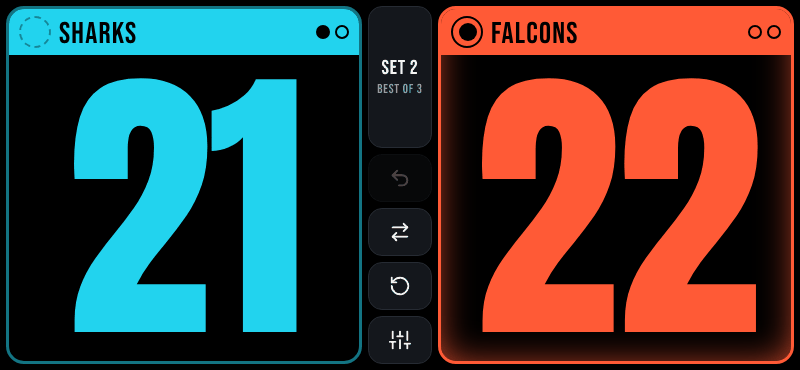
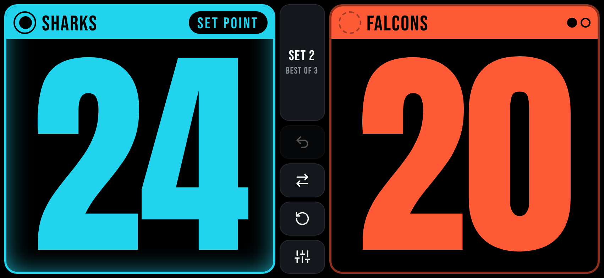
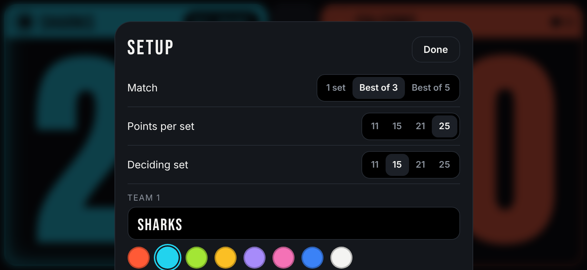

<div align="center">


# Rally — Volleyball Scoreboard

**A fast, ad-free volleyball scoreboard that installs on your phone like a real app.**
Tap to score, read it from across the court, and never watch an ad to reset 0–0 again.

**Live Site:** [https://alex-gamero.github.io/volley-score/](https://alex-gamero.github.io/volley-score/)




</div>

---

## Why I built it
I play open volleyball, and I was keeping score with a free app from the Play Store. Every time I reset the score to 0, it showed me a full-screen ad. It happened every set, every game.

So I built my own. Rally has **no ads, no accounts and no tracking**. It runs offline in the gym, and it's designed so the people on the court can read the score from far away.

---

## Features
| | |
|---|---|
| 🏐 **Real volleyball rules** | Sets to 11 / 15 / 21 / 25, win by 2, single set or best of 3 / 5, plus a shorter deciding set |
| 👀 **Readable from the court** | Full-height numbers in a heavy display font, bright team colors on pure black |
| 🎯 **SET POINT / MATCH POINT** | Shows automatically. Match point pulses so nobody misses it. |
| 🔄 **Serve tracking** | The serve indicator follows the rally winner, and the serving side glows |
| ↔️ **Side switching** | Swaps sides after each set, with a *SWITCH SIDES* alert at 8 in the deciding set |
| ↩️ **Unlimited undo** | Fixes any mistake, even after a set or match has ended |
| 🎨 **Team names & colors** | 8 high-contrast colors to pick from |
| 📴 **Works offline** | A service worker caches everything after the first load |
| 💾 **Never loses a game** | The score is saved on the device, so closing the app by accident is fine |
| 📳 **Feels native** | Haptic feedback, screen kept awake, fullscreen landscape lock |

---

## Screenshots
<div align="center">

**Set point, best of 3**


**Setup**


</div>

---

## How it works
| Action | Gesture |
|---|---|
| Add a point | **Tap** a team's side |
| Remove a point | **Swipe down** on a team's side |
| Set who serves | Tap the **circle** next to the team name |
| Undo / Swap / Reset / Setup | Buttons in the center column |

When a set ends, a card shows the winner and the score. Tap **Next set** to keep going, or **Undo point** if it was a mistake.

---

## Install it on your phone (Android)
1. Open **[alex-gamero.github.io/volley-score](https://alex-gamero.github.io/volley-score/)** in **Chrome**.
2. Tap **⋮ → Add to Home screen → Install**.
3. Launch it from your home screen. It opens fullscreen and sideways, like a native app.

You don't need the Play Store. Updates install themselves the next time you open the app with internet on.

---

## 🛠️ Tech Stack
- **HTML5, CSS3 & vanilla JavaScript.** No frameworks, no build step, no dependencies.
- **Progressive Web App:** a Web App Manifest and a Service Worker for installing and running offline
- **Web APIs:** Screen Wake Lock, Vibration, Screen Orientation Lock, `localStorage`
- **CSS container queries,** which size the score to fill each panel on any screen
- **Self-hosted fonts:** Anton & Bebas Neue (SIL OFL)
- **Hosting:** GitHub Pages

### Project structure
```
volley-score/
├── index.html            # Markup
├── styles.css            # Layout & visual design
├── app.js                # Scoring rules, state, undo history, UI
├── sw.js                 # Service worker (offline cache)
├── manifest.webmanifest  # Install metadata (icon, landscape, fullscreen)
├── icons/                # App icons (incl. maskable)
└── fonts/                # Self-hosted fonts
```

### Run locally
```bash
git clone https://github.com/alex-gamero/volley-score.git
cd volley-score
python -m http.server 8000
# open http://localhost:8000
```

---

## Coming Soon
- Match history and stats (points per set, longest run)
- Rotation tracker for the serving order
- Timeouts with a countdown
- Voice announcements of the score

---

## Contributing
Got an idea or found a bug? Open an **issue** or submit a **pull request**!

<div align="center">

Made with 🏐 by [Alex Gamero](https://github.com/alex-gamero)

</div>
