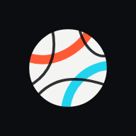
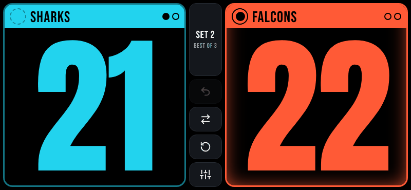
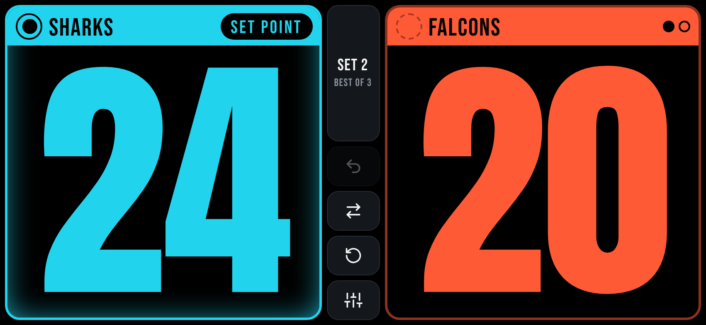
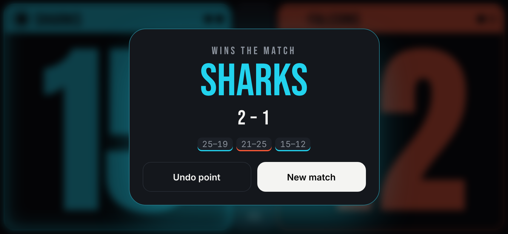

<div align="center">



# Rally

**Ad-free volleyball scoreboard you can install on your phone.**
Tap to score, read it from across the court, and reset to 0–0 without sitting through an ad.

**Live Site:** [https://alex-gamero.github.io/Rally/](https://alex-gamero.github.io/Rally/)




</div>

---

## Screenshots
| Match point in the deciding set | Match won |
|:---:|:---:|
|  |  |

---

## How it works
| Action | Gesture |
|---|---|
| Add a point | **Tap** a team's side |
| Remove a point | **Swipe down** on a team's side |
| Set who serves | Tap the **circle** next to the team name |
| Undo / Swap / Reset / Setup | Buttons in the center column |

When a set ends, a card shows the winner and the score. Tap **Next set** to keep going, or **Undo point** if it was a mistake.

---

## Install it on your phone (Android)
1. Open **[alex-gamero.github.io/Rally](https://alex-gamero.github.io/Rally/)** in **Chrome**.
2. Tap **⋮ → Add to Home screen → Install**.
3. Open it from your home screen. It runs fullscreen and sideways, like a native app.

You don't need the Play Store. The app updates itself the next time you open it with internet on.

---

## 🛠️ Tech Stack
- **HTML5, CSS3 & vanilla JavaScript.** No frameworks, no build step, no dependencies.
- **Progressive Web App:** a Web App Manifest and a Service Worker for installing and running offline
- **Web APIs:** Screen Wake Lock, Vibration, Screen Orientation Lock, `localStorage`
- **CSS container queries,** which size the score to fill each panel on any screen
- **Self-hosted fonts:** Anton & Bebas Neue (SIL OFL)
- **Hosting:** GitHub Pages

### Project structure
```
Rally/
├── index.html            # Markup
├── styles.css            # Layout & visual design
├── app.js                # Scoring rules, state, undo history, UI
├── sw.js                 # Service worker (offline cache)
├── manifest.webmanifest  # Install metadata (icon, landscape, fullscreen)
├── icons/                # App icons (incl. maskable)
└── fonts/                # Self-hosted fonts
```

### Run locally
```bash
git clone https://github.com/alex-gamero/Rally.git
cd Rally
python -m http.server 8000
# open http://localhost:8000
```

---

## Coming Soon
- Match history and stats (points per set, longest run)
- Rotation tracker for the serving order
- Timeouts with a countdown
- Voice announcements of the score

---

## Contributing
Got an idea or found a bug? Open an **issue** or submit a **pull request**!
